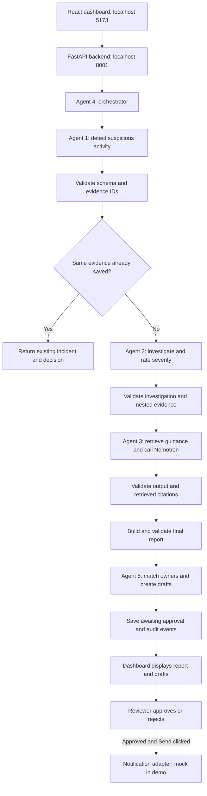

# SentinelAI: technical agent flow and frontend walkthrough

This guide explains the current implementation, what each agent does, where its
results appear, and how to demonstrate it to a judge.

**Main idea:** Python rules detect and investigate suspicious activity; RAG supplies
security references; Nemotron writes grounded guidance; owner rules prepare
focused notification drafts; a human controls approval and delivery.

## 1. The complete flow



This diagram shows the responsibilities, not the exact placement of every line.
For example, the orchestrator checks for an existing evidence set before persisting
a new detection, and validates evidence before consuming subsequent results.

Agent 4 manages the entire sequence. It is not an AI call that runs only after
Agent 3. The frontend's five tabs are an explanation of the workflow, not five
independent model calls.

## 2. Where processing happens

| Component | Responsibility |
|---|---|
| React frontend | Login, display reports, inspect evidence/references, invoke backend actions |
| FastAPI backend | Authentication, authorization, agents, validation, persistence, audit |
| P1 SQLite store | Exact logs, accounts, permissions, inventory, and native incident records |
| P3 SQLite store | Application incidents/state, owner data, notification drafts, API audit records |
| ChromaDB | Embedded knowledge-document sections for semantic retrieval |
| Local embedding model | Converts document/query text into vectors; `all-MiniLM-L6-v2` |
| Nemotron on Brev | Produces structured recommendations from the supplied investigation and sources |
| SSH forward on port 8000 | Private connection from the local backend to remote vLLM |

The browser never reads `.env` or receives the model API key. It calls FastAPI;
FastAPI calls the model. The current repository retains separate P1/P3 SQLite
stores with adapters; it has not been migrated to one atomic database.

## 3. Agent 1 — Threat Detection

**Code:** [threat_detection.py](../backend/agents/threat_detection.py)  
**Function:** `detect(filters=None) -> list[dict]`  
**Uses Nemotron?** No. Detection uses deterministic Python rules.

### Input and processing

1. Read security events through P1's query tools.
2. Look up account known IPs, permissions, approved networks, maintenance windows,
   and asset criticality.
3. Skip activity covered by an approved maintenance window.
4. Apply these rules:

| Rule | Trigger |
|---|---|
| R1 | Successful login from an unfamiliar IP outside approved networks |
| R2 | Server access without a currently valid permission |
| R3 | At least five failed logins for an account within a ten-minute sliding window |
| R4 | At least three distinct assets accessed from the same account/untrusted source within fifteen minutes |

Off-hours activity adds context; it does not trigger an incident alone. The
implemented office window is Mon–Fri, 07:00–19:00 UTC.

Flagged events are grouped by account and source IP, with each event no more than
30 minutes after the previous one. Agent 1 assigns an incident ID, reusing the
native saved ID when the evidence set already exists.

### Output

A detection contains `incident_id`, `summary`, `severity_initial`, `account_ids`,
`source_ip_addresses`, `affected_asset_ids`, `time_window`, `evidence_ids`,
`reasons`, `uncertainties`, and `rules_triggered`.

### Frontend mapping

- Left sidebar: incident ID and summary.
- Incident header: summary.
- Metric strip: account, time window, and affected-asset count.
- **1 · Detect** tab: the rule-based reasons for flagging the incident.

**Judge explanation:** “We flag activity using reproducible rules and preserve the
exact log IDs. The language model does not decide whether an alert exists.”

## 4. Agent 2 — Investigation and Impact Analysis

**Code:** [investigation.py](../backend/agents/investigation.py)  
**Function:** `investigate(detection) -> dict`  
**Uses Nemotron?** No. The current implementation is deterministic.

### Input and processing

1. Receive Agent 1's detection and validate its required input.
2. Read relevant events around the incident, including a 30-minute context window
   before and after the detected time window.
3. Build a timestamped timeline with supporting evidence IDs.
4. Check permissions at the event's actual timestamp:
   `valid_from <= event_time < valid_until`; no expiry means an open-ended grant.
5. Classify access as `authorized`, `expired`, or `none`.
6. Separate confirmed facts from hypotheses and benign explanations to check.
7. Check approved networks, maintenance windows, and prior account activity.
8. Rate severity using the Python rubric in [severity.py](../backend/agents/severity.py).

For this scenario, a privileged account plus unauthorized/expired access and
multiple or important assets produces **high** severity. A critical asset does
not automatically make the incident critical. The code reserves critical severity
for unauthorized activity with confirmed severe impact; current Agent 2 passes
`impact_confirmed=False`.

### Output

`investigation_status`, `timeline`, `affected_assets`, `potential_impact`,
`confirmed_facts`, `hypotheses`, `benign_explanations_to_check`, `checks_performed`,
`severity`, `confidence`, and `evidence_ids`, alongside the incident ID.

The integration adapter adds explicit search/workflow fields: normalized status,
detection reasons, permission IDs, and affected-asset IDs. It validates the native
output before doing this conversion.

### Frontend mapping

- **2 · Investigate** tab: confirmed facts and expandable evidence IDs.
- **What happened** panel: timeline when available and impact/context summary.
- **Affected assets** panel: machines, importance, and responsible teams.
- Header and metric strip: final rule-based severity.
- Confidence and every internal hypothesis are not separately displayed in the
  current dashboard.

**Judge explanation:** “This step checks what the account was allowed to do at that
time. An expired permission is different from a valid permission or no permission.”

## 5. Agent 3 — Intelligence: RAG plus Nemotron

**Code:** [intelligence.py](../backend/agents/intelligence.py)  
**Function:** `analyze(investigation) -> dict`  
**Uses Nemotron?** Yes, when configured and valid sources are available.

### Preparation: knowledge ingestion

`python -m backend.rag.ingest` performs this setup separately from each incident:

```text
MITRE/policy/case Markdown
  → parse front matter
  → split at section headings
  → embed section text using MiniLM
  → store vectors, text, and metadata in ChromaDB
```

Normal ingestion indexes 11 documents / 38 sections in the current corpus.
`test_fixtures/` is excluded unless explicitly enabled. Logs remain in SQLite;
raw logs are not indexed as knowledge documents.

### Runtime retrieval

1. Build a query from status, reasons, and confirmed facts.
2. Embed the query with the same model used during ingestion.
3. Search separately for:

| Knowledge group | Maximum chunks |
|---|---:|
| Official MITRE ATT&CK references | 3 |
| Internal sample policies | 3 |
| Sample historical incidents | 2 |

4. Convert Chroma's squared-L2 distance to `score = 1 / (1 + distance)`.
5. Retain scores at least `0.4`; deduplicate results.
6. Record the actual selected source IDs for independent citation checks.

These are similarity scores, not probabilities. A technique can be a retrieved
candidate without proving that attack happened. No cross-encoder reranker or
model-controlled follow-up retrieval loop is implemented.

### Nemotron request

The backend sends the investigation and retrieved sections through
[NemotronClient](../backend/llm/nemotron_client.py):

```text
Backend → localhost:8000/v1 → SSH tunnel → Brev vLLM → Nemotron Nano 9B v2
```

- The configured model ID is `nvidia/NVIDIA-Nemotron-Nano-9B-v2`.
- The client uses the OpenAI-compatible API, a 30-second request timeout, and one
  retry for transient request failures.
- Nano v2's `/no_think` control requests final output without a reasoning prefix.
- Greedy generation and a 2048-token output budget were verified against the
  existing server's 8192-token context limit.
- All supplied investigation/document content is untrusted, explicitly labelled,
  and escaped. Template-control strings inside untrusted content are encoded too.
- Output must be a JSON object; malformed output is not repaired or extracted
  from surrounding reasoning text.

### Output and validation

| Output group | Purpose |
|---|---|
| `matched_techniques` | Candidate MITRE techniques and relevance |
| `policy_references` | Applicable policy sections and summaries |
| `historical_cases` | Similar past cases for context |
| `recommended_actions` | Suggested next steps with source document IDs |
| `recommended_resources` | Resources whose URLs exist in retrieved metadata |
| `limitations` | Gaps and uncertainty |

Pydantic validates the response. Unsupported citation IDs are removed with a
limitation; ungrounded entries or invalid output are rejected. The code checks
technique/case identities, policy sections, URLs, identifiers in prose, prohibited
claims, and unapproved email addresses. POL-099 is excluded from usable guidance.

These checks verify provenance and structure; they do not prove every generated
sentence is semantically correct. Model wording still requires analyst review.

### Fallback

- Empty API key: do not call the model.
- Timeout, unavailable endpoint, malformed JSON, or unacceptable output: return
  deterministic source-based guidance with **“AI summary unavailable; showing
  retrieved sources only.”**
- No relevant retrieval: return empty guidance and **“No relevant source was
  retrieved.”**

### Frontend mapping

- **3 · Intelligence** tab: recommendations, source IDs, limitations, and expandable
  policy/case/technique references.
- **Guidance & next steps** panel: saved techniques, actions, and policy references.
- **Generate AI preview**: fresh Agent 3 analysis using the saved investigation.
- **Generated by Nemotron**: generation passed the output checks.
- **Source-only fallback**: validated model generation was not used.

The expandable references display output summaries/relevance and IDs; they are
not a full original-document viewer. Resource URLs are returned in the backend
contract but are not all rendered as clickable links in the current UI.

**Judge explanation:** “We retrieve relevant security guidance first, then ask
Nemotron for recommendations. Every accepted recommendation must cite retrieved
sources; missing or invalid AI output is visibly labelled fallback.”

## 6. Agent 4 — Orchestrator and Validation

**Code:** [orchestrator.py](../backend/workflow/orchestrator.py),
[validators.py](../backend/workflow/validators.py),
[state.py](../backend/workflow/state.py),
[integration.py](../backend/workflow/integration.py)  
**Function:** `run_incident_workflow() -> list[IncidentState]`  
**Uses Nemotron?** It invokes Agent 3; workflow control itself is Python.

### Processing

1. Call Agent 1 and validate each detection.
2. Look up a saved incident by its sorted evidence-ID set.
3. Reuse an existing incident and decision if found; do not rerun its downstream
   agents or create another incident for the same evidence.
4. Validate evidence existence with P1's `event_exists` / `permission_exists`.
5. Invoke Agent 2; validate its schema, incident identity, evidence coverage, and
   nested timeline/permission references.
6. Invoke Agent 3; capture actual retrieval and generation-validation receipts.
7. Validate Agent 3 and independently compare its citations to retrieved IDs.
8. Assemble and validate the final report, retaining P1's severity.
9. Invoke Agent 5 and validate its output and affected-asset associations.
10. Save `awaiting_approval` with pending approval and unsent notifications.
11. Audit each stage, validation outcome, and final status.

`IncidentState` carries detection, investigation, intelligence, employee matches,
final report, approval status, notification status, and errors.

A per-incident failure stops further processing of that incident, preserves
successful intermediate results, records an error, and saves incomplete status
when storage is available. Whole-detector failure is audited and raised without
inventing an incident. Database/setup failures can prevent persistence.

### Frontend mapping

- **4 · Validate** tab: persisted audit events and their details.
- Incident lifecycle badges: awaiting approval, rejected, delivered, or incomplete.
- Saved-report provenance: whether accepted model generation was recorded.
- Repeated **Run demo scenario** reuses existing incidents and approval decisions.

The tabs are navigation over recorded results, not a live progress animation.
“Evidence verified” means references were checked against stored records, not
that an attacker or successful compromise was confirmed.

**Judge explanation:** “The orchestrator is the manager: it calls agents in order,
checks the handoffs, prevents duplicates, and stops safely when a step fails.”

## 7. Agent 5 — Owner Matching and Notification Drafting

**Code:** [employee_notification.py](../backend/agents/employee_notification.py)  
**Function:** `match_and_draft(report) -> list[dict]`  
**Uses Nemotron?** No separate model call. It can use Agent 3's recommendations.

### Processing

1. Read affected assets and evidence from the validated report.
2. Find active asset owners using employee/asset mappings.
3. Exclude backup-only and inactive mappings; use the owner-team channel when no
   active individual owner is available.
4. Group assets by recipient and create one draft per recipient.
5. Include shared login evidence and that owner's asset-specific evidence/facts.
6. Filter recommendations that name another recipient's assets.
7. Include incident ID, evidence IDs, and an escalation contact.
8. Persist drafts idempotently by incident/recipient.

Native draft rows are validated before adaptation to workflow employee matches.
Owner selection remains deterministic; model text does not choose recipients.

### Frontend mapping

- **5 · Notify** tab: current decision and selected owners.
- **Asset owners** panel: names, roles, assigned assets, and selection reasons.
- **Preview message**: individual subject and body.
- Recipient status badges: draft, approved, rejected, mocked, sent, or failed.

**Judge explanation:** “We notify the people responsible for the affected assets,
with focused evidence rather than sending the whole investigation to everyone.”

## 8. Human approval and sending are separate from agent execution

| Action | Backend behavior | Visible result |
|---|---|---|
| Approve | Requires reviewer role and pending/awaiting-approval incident; records approval and approves drafts | Approved badges and Send button |
| Reject | Requires reviewer role and pending/awaiting-approval incident; rejects drafts | Rejected badges |
| Send | Checks approval, recipient/channel allowlists, and prior delivery before invoking adapter | Per-recipient mocked/sent/failed result |

The normal demo uses `NOTIFICATION_MODE=mock`: delivery is simulated. Approving
alone does not send. The workflow does not reset prior decisions on rerun. There
is no automatic account disabling, permission revocation, or infrastructure change.

## 9. Exactly what frontend actions execute

| Frontend event | Endpoint | Does it run agents or the model? |
|---|---|---|
| Sign in | `POST /api/auth/login` | Authenticates; no agent/model call |
| Load sidebar | `GET /api/incidents` | Reads saved incidents |
| Select incident | `GET /api/incidents/{id}` | Reads saved report, recipients, and audit |
| Click workflow tab | No request needed | Changes the visible section only |
| Expand source/message | No request needed | Reveals existing summary or draft |
| Run demo scenario | `POST /api/incidents/run-demo` | Invokes orchestrator; reuses matching saved incidents |
| Test Nemotron | `POST /api/ai/check` | Real nonce-verification model request when key configured; no RAG |
| Generate AI preview | `POST /api/incidents/{id}/preview-intelligence` | Fresh retrieval and Agent 3 generation; no Agents 1/2/5 rerun |
| Approve/reject | `POST /api/incidents/{id}/approve` or `/reject` | Records human decision; no model call |
| Send notifications | `POST /api/incidents/{id}/send` | Uses configured delivery adapter; no model call |
| Export report | Browser print dialog | No model call |

Backend startup also invokes the orchestrator. Loading a saved dashboard does
not, by itself, repeat live inference. The frontend uses authenticated Axios
requests and stores the login session in browser session storage.

## 10. Distinguish the three AI indicators

| Indicator | What it proves | What it does not prove |
|---|---|---|
| Live inference verified | A fresh request returned the expected random nonce and JSON | That the saved report was generated by Nemotron |
| Fresh AI preview: Generated by Nemotron | Fresh RAG/model output passed structure and source checks | That the preview changed saved approval or drafts |
| Saved report: Generated by Nemotron | Generation provenance was persisted for that report | That every generated sentence is correct |

Older reports may say **Generation not recorded**. That is honest missing
metadata, not a failed connection. The preview is held in frontend state; it
can disappear on refresh. The request is audited, but does not overwrite the
saved report, notification bodies, severity, recipients, or approval decision.

## 11. Trace INC-001 through the system

| Stage | Demo example | Frontend location |
|---|---|---|
| Detect | admin_04 uses unfamiliar 198.51.100.24 and reaches multiple assets | Sidebar, summary, Detect tab |
| Investigate | DC-SRV-04 permitted; DC-SRV-05 grant expired; DC-DB-01 denied without permission | Facts, evidence, affected assets |
| Rate severity | Privileged activity plus invalid access on multiple/important assets → high | Header and severity metric |
| Retrieve | Relevant searches include MITRE-T1078, policy guidance, and CASE-002 | Intelligence references |
| Generate | Nemotron proposes cited review/remediation steps | Fresh AI preview |
| Validate | IDs, contracts, citations, and outcomes recorded | Validate tab and audit |
| Draft | EMP-001, EMP-003, EMP-006 are the expected owners | Asset owners and message previews |
| Human review | Reviewer approves or rejects; mock send only after approval | Decision buttons and recipient badges |

The data is synthetic, with an official MITRE reference subset. This is a
working prototype over seeded records, not a production log-stream integration.

## 12. A concise judge presentation

**Opening:** “SentinelAI connects suspicious activity to evidence, security
guidance, and the people responsible for the affected machines.”

1. Select INC-001: “Python rules found unusual privileged activity.”
2. Open Investigate: “We verify permission validity at the time of access and
   preserve exact evidence IDs.”
3. Click Test Nemotron: “This verifies our real model deployed on Brev.”
4. Click Generate AI preview: “We retrieve relevant documents, then generate
   structured recommendations with source references and independent validation.”
5. Expand a policy/case: “The reviewer can inspect the cited reference summary.”
6. Open Validate: “Every workflow handoff and reviewer action is auditable.”
7. Show owner drafts: “The relevant owners receive focused messages only after
   human approval. The demo sender is simulated.”

**Closing:** “The model explains and recommends. Deterministic code controls
severity, evidence validation, recipients, and approval gates.”

For startup commands see [how-to-run.md](how-to-run.md). For the executed live
checks and screenshots see [runtime-check-results.md](runtime-check-results.md).
